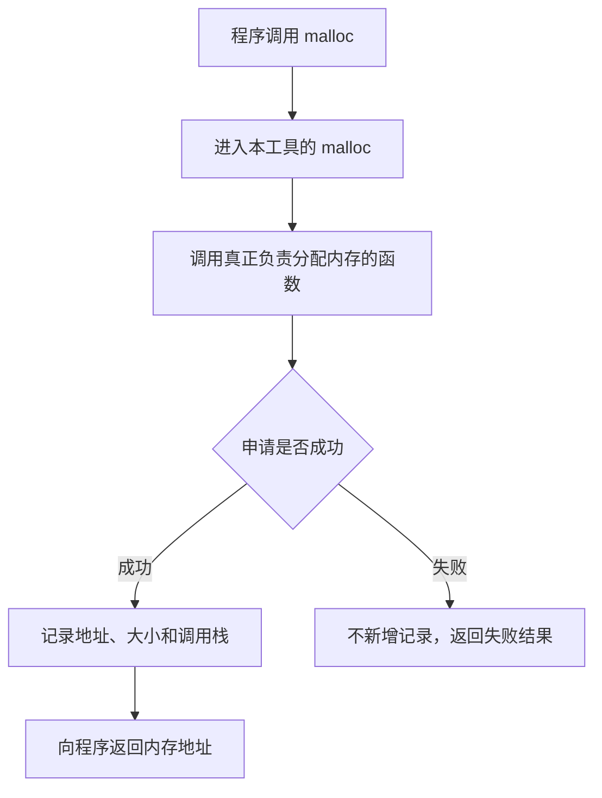
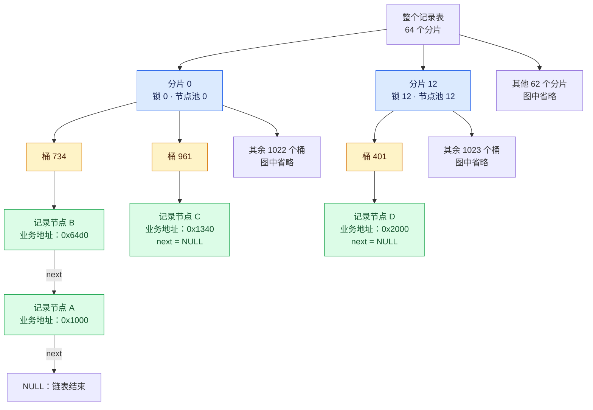

# mem_snapshot 详细设计：从一次内存申请讲起

本工具在程序申请内存时登记，在程序释放内存时删除对应记录。用户需要检查时，工具把当时仍在表中的记录写入文件。记录包含内存地址、申请大小，以及申请时经过的函数，便于排查哪些内存可能没有按预期释放。

本文面向了解 `malloc`、`free`，但不一定熟悉 Linux 动态链接、哈希表和线程同步的读者。每一节先说明问题和处理过程，再解释实现中使用的名称。

设计适用于 Linux/glibc 下的动态链接程序。glibc 是本项目所针对的 C 运行库，提供真正的内存分配函数。动态链接的含义在第 3 节解释。文中的地址、对象数量和业务情景，凡标为“假设示例”的，均用于解释，不是本机实测结果。

本次展开说明日期为 2026-10-25。原技术条目保存在 [原版设计](docs/DESIGN-technical-original.md)。实际操作命令见 [README.md](README.md)，测试与性能实测见 [VALIDATION.md](VALIDATION.md)。

## 阅读顺序

| 章节 | 要回答的问题 |
|---|---|
| 1–2 | 工具究竟记录什么？指针、内存块、记录和调用栈有什么区别？ |
| 3–4 | 如何接住 malloc 调用？free 怎样快速找到对应记录？ |
| 5–7 | 多个线程同时工作怎么办？malloc、free、realloc 的顺序为什么重要？ |
| 8–9 | 其他分配函数怎么处理？工具自己用内存时，为什么不会无限记录自己？ |
| 10–12 | 信号怎样触发快照？快照怎样生成、怎样阅读？ |
| 13–15 | 记录表需要多少空间？为什么会减慢程序？启动、退出和创建子进程时怎么办？ |
| 16–17 | 哪些问题无法覆盖？怎样判断设计是否经过验证？ |

## 1. 从一次申请和释放看全过程

工具维护一张“尚未释放的内存记录表”。可以暂时把这张表理解为账本：申请成功时登记，释放时销账。

这里的账本只记录内存的地址、大小和申请来源，不保存业务数据本身。例如，程序申请内存来存放一张图片，工具会记录图片缓冲区的地址和大小，不会把图片复制到记录表中。

下面是假设示例。程序先申请 1024 字节，再申请 2048 字节，随后释放第一块内存。为了方便阅读，假设两个地址分别为 `0x1000`、`0x2000`；真实地址由运行时决定。

| 时刻 | 程序动作 | 工具中的记录 |
|---|---|---|
| 第一步 | `p = malloc(1024)` 成功，返回 `0x1000` | 登记：`0x1000`，1024 字节 |
| 第二步 | `q = malloc(2048)` 成功，返回 `0x2000` | 保留第一条，再登记第二条 |
| 第三步 | `free(p)` | 删除 `0x1000` 对应的记录 |
| 第四步 | 用户请求查看快照 | 输出仍保留的 `0x2000` 记录 |
| 第五步 | `free(q)` | 删除 `0x2000` 对应的记录 |

快照是“当时记录表内容的一份副本”。以上第四步得到的文件不会因第五步释放内存而自动修改。再次请求快照，才会得到更新后的记录。

如果 `malloc` 申请失败并返回 `NULL`，程序没有得到这块内存，工具也不新增记录。

### 尚未释放，为什么不能直接叫泄漏？

工具知道一块内存何时申请、是否经过释放入口，但不知道业务什么时候不再需要这块内存。

例如，程序还在读取文件时，读文件的缓冲区尚未释放是正常的。如果文件已经处理完，缓冲区也不再需要，程序却遗漏了释放操作，就需要排查。如果程序还丢失了这块内存的所有可用指针，则属于典型的内存泄漏情形。

判断要结合内存的“使用生命周期”：这块内存为哪项工作申请，这项工作什么时候结束，结束后是否还要保留这块内存。

缓存就是一个需要区别对待的例子。某次请求处理完后，程序可能有意保留结果，供下次请求使用。因此，“请求结束后还存在”也不能单独证明泄漏。

工具提供申请来源和变化情况，帮助定位排查范围。最终判断仍需要结合代码的工作流程。

## 2. 先分清内存块、指针、记录和调用栈

后面的设计反复使用这四个概念。先把每个对象说清楚，才能理解工具为何需要额外的数据结构。

### 2.1 内存块与指针

以这一行假设代码为例：

```c
char *p = malloc(1024);
```

申请成功后，程序得到一块 1024 字节的内存。`p` 保存这块内存的起始地址。程序通过这个地址读写内存，也通过这个地址告诉 `free` 要释放哪一块内存。

这里存在两个不同的对象：

- 指针变量 `p`：保存地址。
- `p` 指向的内存块：保存程序实际使用的数据。

通过 `malloc` 等函数动态申请的这类内存，通常称为“堆内存”。“分配”就是申请并取得可用内存的过程。因此，“一次堆内存分配成功”可以先理解为“一次 malloc 等申请操作成功，程序得到了一块内存”。

局部指针变量离开作用域，并不会自动替程序释放指针所指向的堆内存。若该内存不再需要，程序仍需按约定调用释放函数。

原版中的“存活内存”或“存活对象”，在本工具里仅指已经申请成功、当前尚未释放的内存块。这个词不说明内存是否仍有用途，也不说明是否还有指针能找到这块内存。

### 2.2 一块业务内存，对应一条工具记录

工具要另外保存一条记录，描述这块业务内存。记录本身也占内存，但与业务申请的那块内存分开存放。

仍以上面的假设申请为例：

```text
程序的指针 p ──────────────→ 1024 字节的业务内存
                                  地址假设为 0x1000

工具的记录节点 ────────────→ 保存地址 0x1000、大小 1024、编号和调用栈
```

“节点”在这里是一份记录的存储单元。后面用链表连接记录时，每个节点还保存“下一个节点在哪里”。

`free(p)` 收到的是业务内存地址，**没有收到记录节点的地址**。因此，工具还要根据业务内存地址查找对应记录。这正是需要设计高效查找方式的原因。

每条记录包含：

| 字段 | 保存什么 | 为什么需要 |
|---|---|---|
| `ptr` | 业务内存的起始地址 | 与 `free` 传入的地址对应 |
| `size` | 程序请求的字节数 | 判断哪些申请占用了多少内存 |
| `id` | 本条记录的编号 | 区分不同的分配记录 |
| `depth` | 实际记录了多少层调用栈 | 说明后面有多少条调用栈地址 |
| `frames` | 调用栈中的地址 | 查找申请来自哪些函数和代码位置 |
| `next` | 同一链表中的下一个记录节点 | 连接需要一起查找的记录 |

`size` 记录的是程序请求的大小。分配器内部为了管理、对齐而实际占用的空间，可能比这个数大；日志没有把两者混为同一指标。

内存地址可能重复使用。假设一个位于 `0x1000` 的对象释放了，后来另一次申请又得到 `0x1000`，两次申请是不同事件。记录编号可以帮助区分这两条记录，不能只凭地址相同就认为是同一个对象。

### 2.3 调用栈说明“程序怎样走到这次申请”

假设主函数处理一个请求，请求处理函数又调用文件读取函数，最后才申请缓冲区：

```text
main
  → handle_request
    → read_file
      → malloc
```

这条嵌套调用关系就是理解“调用栈”的起点。记录这条路径后，排查者可以看到：这块内存来自文件读取过程，而不仅仅知道程序执行过 `malloc`。

本工具通过 `backtrace` 获取调用栈。`backtrace` 是用于收集当前调用栈地址的函数。为了避免每次申请时都解析函数名和源文件行号，工具先保存地址，在输出或离线分析时再解释地址。

“原始返回地址”是调用栈中保存的一种代码地址，通常与被调用函数返回后继续执行的位置有关。初次阅读设计时，只需把它理解为后续定位代码所需的地址信息。

“堆内存”中的“堆”和“调用栈”中的“栈”，在这里承担不同角色：前者是被申请、被释放的业务内存；后者用于描述申请发生时的函数调用过程。

默认最多记录 16 层，最多可配置为 32 层。如果实际只能获取到更少的层数，记录中的 `depth` 就会更小。配置为 16 不代表每次必定得到 16 层完整信息。

## 3. 程序为什么会先调用本工具？

本工具提供与 glibc 同名的 `malloc`、`free` 等函数，让符合条件的调用先进入本工具，再转交给真正负责内存分配的函数。

### 3.1 动态链接与 LD_PRELOAD

动态链接程序在运行时需要装入共享库。共享库可以理解为多个程序能够调用的一组函数；Linux 上常见的文件扩展名为 `.so`。

程序启动时，动态加载器负责装入这些库，并为函数调用寻找对应实现。例如，程序需要调用 `malloc`，加载器需要确定这次调用使用哪个库提供的 `malloc`。

`LD_PRELOAD` 是控制预先加载共享库的环境变量。本工具使用这个机制，让自己的共享库先参与函数名称的查找。在本项目支持的调用情形下，程序对 `malloc` 的调用就会先进入本工具的同名函数。

底层采用 ELF 的符号查找机制。ELF 是 Linux 上常见的可执行文件和共享库格式；“符号”在这里可以先理解为可供查找的函数名称，例如 `malloc`。原版所说的“同名 ELF 符号拦截”，描述的就是这个过程。

### 3.2 本工具接到调用后做什么？



本工具中的同名函数属于“包装函数”：先接住调用，在真实函数执行前后附加记录操作，再把真实结果交给程序。

为了找到后续的真实函数，本工具调用 `dlsym(RTLD_NEXT, "malloc")`：

- `dlsym` 用于按名称查找函数地址。
- `"malloc"` 是要查找的函数名称。
- `RTLD_NEXT` 表示从当前库之后继续查找，避免又找到本工具自己。

找到的函数地址会保存起来，之后通过这个地址调用真实函数。保存函数地址的变量称为“函数指针”。

`RTLD_NEXT` 的含义是“后续匹配的实现”。如果同时预加载多个替换分配器的库，后续实现未必就是 glibc。因此，第一版没有把任意预加载组合纳入支持承诺。

当前方案也不采用历史上的 `__malloc_hook`，不依赖 glibc 私有的 `__libc_malloc`。这两个名称是技术选型的补充，不是使用本工具需要掌握的接口。

### 3.3 这种方式有怎样的覆盖边界？

工具只能记录经过这些包装函数的调用。程序若使用绕过这些入口的隐藏函数、私有分配方式，或者绕过 malloc 直接向操作系统申请内存空间，就可能不经过这张记录表。后面会解释的 `mmap` 就属于需要区别对待的接口。

静态链接程序的函数连接方式不同，不能直接套用当前的启动预加载方案。出于安全执行规则而忽略 `LD_PRELOAD` 的进程，也不在当前方案的覆盖范围内。

这些限制意味着：日志没有出现某块内存，不能直接证明程序没有申请那块内存。

## 4. free 怎样快速找到对应记录？

采用“按地址计算位置，再在小范围内查找”的方式，避免每次 `free` 都从头扫描全部记录。实现使用分片哈希表，桶内保留短链表。

### 4.1 普通链表为什么可能慢？

链表把记录一个接一个地连接起来。假设链表中有 10 万条记录，而 `free` 要找的地址恰好在最后，工具可能需要检查前面的每一条，才能找到目标。

双向链表也不能直接解决这个问题。双向链表便于删除“已经找到的节点”，但 `free` 只知道业务内存地址，仍然需要先找到对应节点。

这里的瓶颈是查找，不只是把节点从链上摘掉。

这种查找常用 `O(N)` 表示：记录数量为 N 时，查找工作量可能随 N 增长。这个记号描述增长规律，不表示某个固定的耗时。

### 4.2 哈希表先缩小查找范围

哈希函数把一个内存地址转换成一个数字，再用这个数字确定记录放在哪里。相同地址按相同规则计算，得到的位置也相同。

可以把记录表想象成带编号的抽屉。申请时，根据地址计算抽屉号，把记录放进去；释放时，根据同一个地址算出同一个抽屉号，只检查这个抽屉。

实现中把这样的抽屉称为“桶”。下面使用假设地址 `0x1000` 说明流程；分片号和桶号按当前代码的哈希规则计算，并与第 4.6 节的结构图对应。这不是实际申请内存的运行记录。

```text
申请地址 0x1000
    ↓ 对地址计算哈希值
分片 0，桶 734
    ↓
存入地址为 0x1000 的记录

之后 free(0x1000)
    ↓ 使用同样的计算规则
再次找到分片 0，桶 734
    ↓
在这个桶内查找并删除对应记录
```

### 4.3 多个地址落进同一个桶怎么办？

不同地址可能算出同一个桶号，这称为“哈希冲突”。冲突本身是允许的，不表示记录出错。

同一个桶里的记录用单链表连接。例如，假设先登记 `0x1000`，再登记 `0x64d0`。两个地址按当前规则都进入分片 0 的桶 734。由于新记录插在链表头部，后登记的记录排在前面：

```text
桶 734
    → 地址 0x64d0 的记录
    → 地址 0x1000 的记录
    → 链表结束
```

查找 `0x1000` 时，工具只检查这个桶中的节点，并逐个比较完整地址。工具不会因为桶号相同，就把两个地址当成同一块内存。

因此，链表仍然存在，但不再把全部记录放在一条链上。

### 4.4 为什么说平均 O(1)，又不能保证始终一样快？

如果记录分布较均匀，每个桶里的链就较短。一次查找通常只需计算位置并比较少数节点，这称为平均 `O(1)` 查找。

平均 `O(1)` 不表示“只执行一条机器指令”，也不表示“不管有多少记录都保证同样快”。桶内记录变多、线程争用锁、内存访问变慢，仍会增加耗时。极端情况下，记录集中到一条长链，查找仍可能退化到 `O(N)`。

另一种选择是平衡树：通过逐步比较缩小范围，查找工作量通常按 `O(log N)` 增长。但树节点的维护和同步也有成本。当前设计选择哈希表，以配合按地址直接查找这一需求；这不代表对所有场景都证明了哈希表最快。

### 4.5 当前具体分成多少分片、多少桶？

分片和前文所说的“组”是同一个概念。记录表包含 64 个分片，每个分片有 1024 个桶，总计 65536 个桶。

这里划分的是工具保存的记录，并没有把应用的堆内存物理切成 64 块。不同地址的记录可以放入同一个分片，并不要求这些业务内存的地址相邻。

指针地址会先经过整数混合计算，再从计算结果中取不同的位来选择分片和桶。这样设计是因为内存地址通常有对齐规律，不能简单假设地址最低几位均匀变化。

计算规则可简化表达为：

```text
h = pointer_hash(p)
分片编号 = h & 63
桶编号   = (h >> 6) & 1023
```

其中，`h & 63` 取出哈希值最低的 6 位，得到 0–63 的分片编号。`h >> 6` 先移开这 6 位，再用 `& 1023` 取接下来的 10 位，得到 0–1023 的桶编号。这里分别使用 6 位和 10 位，是因为 2 的 6 次方为 64，2 的 10 次方为 1024。

默认每个分片最多保存 4096 条记录，由该分片的全部 1024 个桶共同使用这个上限。如果所有分片都达到上限，总容量为 262144 条记录。用总容量除以总桶数，得到每桶平均 4 条；这是容量达到上限时的总体平均，不是每个桶都只能放 4 条，也不是每个桶都会恰好有 4 条。

### 4.6 分片、桶和记录节点的完整结构示例

整体结构为：**整个记录表 → 64 个分片 → 每片 1024 个桶 → 桶内的记录链表**。

每个分片单独保存以下管理数据：

| 内容 | 用途 |
|---|---|
| 一把互斥锁 | 保护这个分片内的记录修改 |
| 1024 个哈希桶 | 每个桶保存本桶链表的首节点地址 |
| 一个空闲节点池 | 保存可以重复使用的记录节点 |
| 统计数据 | 保存记录数量、字节数、漏记次数等 |
| 一个记录序号 | 用于生成新记录的编号 |

64 个分片主要用于减少锁竞争；每片 1024 个桶主要用于缩小查找范围。两个线程即使访问同一分片的不同桶，仍然要使用同一把分片锁。不同分片则有各自的锁。第 5 节会展开解释这些锁怎样保护记录修改。

下面的业务地址是**假设示例，不是实际申请结果**；分片号和桶号按当前代码的哈希规则计算。假设依次登记 `0x1000`、`0x64d0`、`0x1340`、`0x2000`，记录表中的位置如下：



图中的 A、B、C、D 是示例节点标签，不是程序实际生成的记录 ID。节点中保存业务内存地址，不表示记录节点本身就位于该业务地址。

从图中可以观察到：

- `0x1000` 和 `0x64d0` 都进入分片 0、桶 734，发生哈希冲突，因此用链表连接。后登记的 `0x64d0` 排在前面。
- `0x1340` 也进入分片 0，但位于桶 961。它不与前两条记录共用链表，修改时却共用分片 0 的锁。
- `0x2000` 进入分片 12、桶 401，使用分片 12 的锁和节点池。

假设现在调用 `free(0x1000)`，工具会执行：

1. 根据 `0x1000` 计算出分片 0、桶 734。
2. 取得分片 0 的锁。
3. 检查第一条记录：地址为 `0x64d0`，不匹配。
4. 检查下一条记录：地址为 `0x1000`，找到目标。
5. 摘下该记录节点，让前一节点的 `next` 指向 `NULL`，并把摘下的节点归还分片 0 的节点池。
6. 释放分片锁，再调用真实 `free` 释放业务内存。

这次查找只检查桶 734 中的两条记录，不需要检查桶 961，也不需要访问其他分片。先摘下记录、再释放业务内存的原因，见第 6 节。

## 5. 多个线程同时操作怎么办？

每个分片有一把锁。线程修改某个分片的记录时，先取得这把锁，完成修改后再释放，让同一分片中的修改有先后顺序。

### 5.1 为什么需要锁？

线程可以理解为同一个进程中的不同执行流程。多个线程可能同时申请和释放内存，并访问同一张记录表。

如果两个线程同时修改同一条链表，一个线程正在连接新节点，另一个线程正在摘除节点，彼此可能读到修改到一半的连接关系。后果可能是记录丢失、链表结构错误，甚至程序崩溃。

“互斥锁”用于约束这种同时修改：一个线程持有锁时，其他需要同一把锁的线程等待。代码使用 `pthread_mutex` 提供这种互斥。

锁保护的是记录表的结构和计数，不是业务内存的读写。本工具不会因此让应用自己不安全的并发读写变得安全。

### 5.2 为什么不把整张表只配一把锁？

如果只有一把总锁，线程修改任何记录都需要先取得这把锁。即使两个线程处理完全不同的地址，也可能必须互相等待。

分成 64 组后，不同组的修改可以使用不同的锁。只有访问同一组的线程才需要争用该组的锁。组数 64 不表示必须有 64 个线程，也不要求机器有 64 个 CPU 核心。

“锁竞争”就是多个线程在同一时间需要同一把锁，其中有线程必须等待。分片减少了共享同一把锁的范围，但不会消除所有等待。

### 5.3 为什么释放内存的线程可以与申请线程不同？

分片位置根据内存地址计算，与线程编号无关。

假设线程 A 申请了一块内存，之后把指针交给线程 B。线程 B 调用 `free` 时，工具仍然能根据这个地址算出原来的分片和桶。因此，不需要去线程 A 的私人记录表中寻找。

每个分片还维护自己的记录序号、空闲节点和统计数量，避免每次调用都修改同一个全局编号计数器。记录 ID 结合分片编号和分片内序号生成。

### 5.4 持有锁期间做哪些事？

锁内主要完成查找、插入、摘除、节点回收和计数更新。节点池需要新增一批记录空间时，也会在所属分片的锁内处理。

调用栈采集放在锁外，文件输出也不在分片锁内执行。原因是这些操作耗时不固定，如果放在锁内，等待同一把锁的线程也必须跟着等待。

第一版使用这样的分片锁方案，没有采用无锁表。“无锁”涉及另一套并发修改和节点回收规则，不能通过删掉互斥锁直接得到。

## 6. malloc 和 free 为什么必须按这个顺序处理？

申请成功后再登记，释放真实内存前先删除记录。这两个顺序决定了表中的记录能否与程序的内存对应起来。

### 6.1 malloc：先申请成功，再登记

正常申请的处理过程是：

1. 进入包装函数，并标记本线程正在执行工具内部逻辑。
2. 调用真实 `malloc` 申请业务内存。
3. 如果失败，返回失败结果，不新增记录。
4. 如果成功，先收集调用栈，再取得对应分片的锁。
5. 取一个记录节点，写入地址、大小、编号和调用栈，把节点放入相应桶。
6. 释放锁，把申请得到的地址返回给程序。

第一步中的内部标记用于防止工具反复记录自己的行为，第 9 节会展开解释。这里先理解为：工具能够区分正在处理业务申请，还是业务申请引起的工具内部操作。

实际分配成功但记录空间不足时，程序仍得到已申请的业务内存。工具增加漏记计数，告诉使用者记录不完整。第 13 节解释容量上限和漏记计数。

### 6.2 free：先删记录，再释放真实内存

正常释放的处理过程是：

1. 根据传入地址计算分片和桶。
2. 取得该分片的锁，找到对应记录。
3. 将记录从桶内链表摘下，并把节点放回空闲节点池。
4. 释放分片锁。
5. 调用真实 `free` 释放业务内存。

找到、删除和回收记录节点在同一次分片加锁期间完成。`free` 不需要采集新的调用栈，因为需要保留的是内存申请的来源。

### 6.3 为什么不能先调用真实 free，再删记录？

因为真实释放完成后，同一个地址可能马上被另一个线程重新申请到。

以下是假设的错误顺序：

```text
线程 A：先释放地址 0x1000 的旧内存
线程 B：申请新内存，恰好再次得到 0x1000，并登记新记录
线程 A：再按地址 0x1000 删除记录
```

最后一步有误删新记录的风险。先删除旧记录，再释放真实内存，可以避免由这个顺序造成的地址复用问题。

### 6.4 NULL、找不到记录和 errno 怎么处理？

`free(NULL)` 不释放任何内存，也不需要查找记录。

如果传入一个普通地址，而记录表中没有对应条目，工具仍调用真实 `free`。缺少记录可能因为申请发生在追踪启用之前，也可能因为记录容量不足，不能仅凭“没有记录”认定指针非法。

这也意味着本工具不提供重复释放保护。程序如果对同一个已释放指针再次调用 `free`，原有的错误不会被工具自动修复。

`errno` 是运行库用来报告错误原因的状态值。工具自己的记录操作可能改变这个值，所以需要保存并恢复，避免给调用者造成错误信息。`free` 保留调用前的 `errno`；分配函数保留真实分配函数返回时的 `errno`。

## 7. realloc 为什么比 malloc 和 free 更复杂？

`realloc` 用于调整一块已有内存的大小。调整成功后，地址可能保持不变，也可能换到新位置。对非零大小的请求，如果调整失败，原内存仍然有效。因此，工具不能一看到 `realloc` 就直接删掉旧记录。

### 7.1 先分清四种结果

以下是假设：原来有一块 1024 字节的内存，地址为 `0x1000`。

| 调整结果 | 业务内存发生什么 | 记录应该怎样处理 |
|---|---|---|
| 调整成功，地址没变 | `0x1000` 对应的内存大小改变 | 更新大小和调用栈，使用新的记录 ID |
| 调整成功，地址改变 | 取得新地址，旧地址不再代表原对象 | 删除旧记录，登记新地址、大小和调用栈 |
| 申请非零大小失败，返回 `NULL` | 原内存仍有效 | 保留原地址、大小、ID 和调用栈 |
| 对非空指针请求大小 0 | 本项目针对的 glibc 会释放原内存 | 实现中返回 `NULL` 时不恢复旧记录；若返回非空结果，则登记结果 |

最后一行是本项目针对 glibc 的处理约定，不能当作所有 C 运行库的通用规则。

`realloc(NULL, n)` 没有原内存需要调整，按申请内存处理。

### 7.2 为什么先把旧记录摘下，但不马上回收？

真实 `realloc` 一旦成功搬迁，就可能释放旧地址。为了避免与旧地址的再次分配混淆，工具先把旧记录从查找表中摘下。

此时只是把记录“暂时拿在手里”，没有丢弃记录内容，也没有把这个节点交给另一条记录使用。等真实 `realloc` 返回后，再决定旧记录的去向：

```text
暂时摘下旧记录，并保存旧记录所属分片
    ↓
调用真实 realloc
    ↓
    ├─ 成功：回收旧记录节点，登记结果
    │
    ├─ 非零大小失败：把原记录放回原处
    │
    └─ 零大小且返回 NULL：回收旧记录节点，不再登记
```

非零大小失败时，恢复的是原记录，包括原来的编号和调用栈。申请失败不能让日志看起来像是原来的内存已经释放。

旧记录所属分片在调用真实 `realloc` 前就计算并保存。这样，真实函数成功释放旧地址后，工具不需要再使用那个已经失效的旧指针来计算分片。

### 7.3 为什么调用真实 realloc 时不持有记录表的锁？

真实 `realloc` 的内部执行过程不由记录表控制。如果在调用期间一直持有表锁，内部再进入需要同一把锁的工具操作，就可能形成无法继续的等待。

当前设计在调用真实 `realloc` 前后分别处理记录，不在整个真实调用期间持有表锁。这样也避免把真实分配器的执行时间全部变成同分片其他线程的等待时间。

### 7.4 更新后的调用栈表示什么？

假设最初由 `create_buffer` 申请，后来由 `grow_buffer` 调用 `realloc` 扩大。扩大成功后，当前记录保存的是 `grow_buffer` 这次成功重分配的调用栈。

因此，日志中的调用栈表示“最近一次成功申请或调整这块内存的位置”。第一版没有另外保存完整的历史变化过程。记录 ID 也会在成功重分配后重新生成。

## 8. 为什么还要处理 calloc 和对齐分配？

程序可以通过多个函数申请内存。如果只处理 `malloc` 和 `free`，使用其他申请函数的代码就可能漏记。因此，设计还覆盖下面这些入口。

| 函数 | 可以怎样理解 | 记录时关注什么 |
|---|---|---|
| `calloc(n, size)` | 申请 n 份、每份 size 字节的空间，并将内容清零 | 成功后记录总请求大小；失败不登记 |
| `realloc` | 调整已有内存的大小 | 按第 7 节处理成功、失败和地址变化 |
| `aligned_alloc`、`memalign` | 申请起始地址满足指定对齐要求的内存 | 转交真实函数，记录成功结果 |
| `posix_memalign` | 另一种指定地址对齐要求的接口 | 通过返回码判断成功，并从输出参数取得指针 |
| `valloc`、`pvalloc` | 按内存页对齐规则申请内存 | 保留真实函数行为，登记成功返回的地址 |

“地址对齐”指起始地址符合某个整除关系。例如，要求 64 字节对齐，可以理解为起始地址必须是 64 的整数倍。这是解释对齐含义的示例，不表示所有调用都要求 64 字节对齐。

“内存页”是操作系统管理内存映射时使用的单位。这里不固定假设所有机器的页大小相同，程序读取运行环境提供的页大小。

### 8.1 calloc 的大小为什么要考虑溢出？

`calloc` 的总请求大小来自 `n × size`。如果乘法结果超过整数能够表示的范围，简单相乘可能得到错误的小数值，这称为整数溢出。

正常路径把这项检查交给真实 `calloc`。本工具用于启动阶段的备用申请路径则自行检查乘法是否超出范围。申请失败不加入记录表。

### 8.2 为什么不能把所有函数都按 malloc 的返回方式处理？

`malloc` 直接返回指针，失败时返回 `NULL`。`posix_memalign` 则返回一个结果码，申请到的指针通过另一个输出参数交给调用者。

因此，包装函数要遵守各自接口的规则。`posix_memalign` 失败时不改写输出指针，也不让工具内部逻辑改变调用者原来的 `errno`。这样，应用对成功和失败的判断才不会因追踪工具而改变。

### 8.3 释放接口和可用大小查询

`cfree`、`free_sized`、`free_aligned_sized` 是兼容的释放入口。当前实现让这些入口通过本工具的 `free` 路径处理，以便删除记录。

`malloc_usable_size` 用于查询分配器认为可用的空间大小。对于真实分配器返回的指针，工具转交查询；对于启动备用区返回的指针，工具返回备用区中保存的大小。这块备用区会在第 9 节展开说明。

当前记录表中的 `size` 仍然是申请时请求的字节数，不因这个查询接口而改成分配器内部的可用大小。

`strdup`、`reallocarray` 等函数也可能间接申请内存。对这些函数，本设计依赖目标 glibc 在内部调用已拦截的分配入口，不能仅凭函数名称就保证所有实现都能完整跟踪。

## 9. 工具自己也需要内存，为什么不会无限记录自己？

工具需要为记录节点和调用栈准备空间。如果这些内部工作又被当成新的业务申请记录，就可能不断重复同一过程。因此，设计分别处理记录节点、自身递归调用和启动时的函数查找。

### 9.1 第一种循环：为记录申请内存，又产生一条记录

假设采用下面的做法：

```text
业务调用 malloc
    ↓
工具想新增一条记录
    ↓
工具调用 malloc 为记录申请空间
    ↓
再次进入工具的 malloc
    ↓
工具又想新增一条记录
    ↓
继续重复
```

这种函数调用间接再次进入自身的现象，属于“递归进入”。如果没有停止条件，程序就不能完成原来的申请。

当前设计通过 `mmap` 从操作系统取得一批记录节点所需的空间，不为每条记录再调用被拦截的 `malloc`。

### 9.2 节点池：一批申请，反复使用

每个分片都有一个节点池。节点池可以理解为“工具已经准备好的空白记录单元”。

当空闲节点用完且容量允许时，工具一次用 `mmap` 取得 256 个节点的空间。之后登记一块业务内存，就从池中取一个空闲节点。

业务内存释放时，工具把对应记录节点归还给节点池。下一次登记可以复用这个节点，不需要再次为它申请空间。

这里有两件分别发生的事：真实 `free` 释放业务内存；记录节点回到工具自己的空闲池。节点池空间保留到进程结束，便于后续复用。

### 9.3 第二种循环：采集调用栈时，运行库内部又申请内存

即使记录节点不使用 `malloc`，调用栈采集或输出过程仍可能间接触发运行库的内存申请。不能假设工具调用的每个库函数都完全不需要内存。

为此，每个线程保存一个内部调用深度。可以先把它理解为“当前线程进入工具内部逻辑多少层”的计数。

线程第一次从业务代码进入包装函数时，正常记录。若线程还没有退出这次内部工作，又因工具自身操作进入分配函数，工具会把这次内部申请交给真实分配器，但不再为这次内部申请新增追踪记录。

这个机制称为“递归保护”。保护标记必须按线程分别保存，否则线程 A 正在记账时，线程 B 的正常业务申请也可能被错误地当成内部申请跳过。

按线程分别保存数据的机制称为 TLS，即线程局部存储。实现采用 `initial-exec` TLS 模型，这是当前启动预加载设计选择的线程局部存储方式。

第一版会排除这类内部递归分配，因此记录表不能被描述成进程所有内存的无遗漏清单。

### 9.4 第三种循环：还没有找到真实 malloc，就已经需要申请内存

启动时，工具要用 `dlsym` 查找真实函数地址。但查找过程本身可能间接申请内存。这时，工具可能还没有可调用的真实 `malloc` 地址。

这是启动阶段的先后依赖问题，不能只靠“直接转交真实 malloc”解决。

因此，工具预留一块 1 MiB 的静态备用区，称为“引导区”。这块空间用于函数地址解析期间的递归申请。此处 `1 MiB` 为 1048576 字节。

引导区按下面的规则工作：

- 从尚未使用的位置分出空间，并满足所需地址对齐。
- 每次申请推进已用位置；推进采用原子操作，避免并发更新时分配出重叠区域。
- 释放引导区指针时不把指针交给 glibc，也不回收引导区的位置。
- 调整引导区对象时，按相应路径申请新空间并复制需要保留的内容。
- 引导区耗尽时，内部申请函数返回 `NULL`，并把 `errno` 设为 `ENOMEM`，表示无法满足申请。对外的包装函数再按各自接口约定报告失败。

“原子操作”在这里表示对共享已用位置的更新不可被另一条更新拆开穿插，从而保护空间分配位置。理解其用途即可，不需要先掌握对应的机器指令。

引导区是有界的启动备用空间，不能无限增长。已经占用的引导空间会在快照中报告。

### 9.5 多个线程同时初始化怎么办？

真实函数地址只初始化一次，使用 `pthread_once` 控制。可以把它理解为“一次性初始化的协调工具”：负责初始化的线程完成工作前，其他线程不能拿到半初始化的函数指针就开始调用。

如果必需的真实函数无法解析，工具输出错误并以状态码 127 终止进程，避免随后调用不存在的函数地址。这个结果与“普通记录容量不足”不同：容量不足时仍能调用真实分配器，函数地址无法解析时则缺少继续工作的基础。

## 10. 为什么收到信号后，不能直接遍历并打印记录？

信号可能在程序执行到任意一段代码时到达。若信号处理函数直接加锁、申请内存或打印，就可能碰到被中断代码尚未完成的状态。

### 10.1 信号是什么？

信号是操作系统向进程传递事件的一种机制。本工具选用 `SIGUSR2` 作为“请生成一份快照”的通知。

进程收到信号后，会执行事先登记的信号处理函数。可以理解为：正常执行暂时被打断，先处理这个事件，再返回原来的执行位置。

### 10.2 一个可能卡住的例子

假设线程 A 正持有某个分片的锁，还没有完成插入记录。此时线程 A 收到了快照信号：

```text
线程 A 持有分片锁，正在修改记录
    ↓ 被信号打断
信号处理函数想取得同一把锁
    ↓
等待线程 A 释放锁
    ↓
但线程 A 要等信号处理函数返回后才能继续
```

这样形成了互相等待，称为“死锁”。程序可能一直卡在这里。

`printf` 等输出函数也可能维护自己的内部状态或锁。因此，问题不只是哈希表有没有加锁，还包括信号处理函数调用的库函数是否适合在被打断的环境中执行。

### 10.3 信号处理函数只递交通知

当前设计把信号处理函数的工作限制为：保存 `errno`，向管道写一个字节，再恢复 `errno` 并返回。

管道可以理解为两个执行流程之间传递字节的通道。信号处理函数写入通知，专门的工作线程读取通知。


管道的写入端设置为非阻塞。如果管道暂时无法容纳更多通知，信号处理函数不会一直等到可以写入，从而避免为通知本身停住业务线程。

“异步信号安全”描述的是函数能否安全地用于这种信号打断场景。当前处理函数不调用 `malloc`、`backtrace`、`printf`，也不取得记录表的锁，只使用为该场景选择的通知操作。

### 10.4 为什么不是每个信号都一定生成一份文件记录？

普通信号本身可能合并；管道里的多条通知也可以由工作线程一次读走并处理。管道满时也允许放弃重复通知。

因此，设计保证的是收到有效通知后尝试生成快照，而不是“发送十次信号就必定得到十份快照”。快照完成与否，要看文件中的完整结束标记。

没有通知时，工作线程阻塞等待管道数据。“阻塞等待”表示先等待通知到来，而不是不停地循环检查有没有通知。

工作线程只负责本工具的内部工作，其内存申请不加入业务追踪表，避免打印一份日志又新增一批待打印的内部记录。

## 11. 快照怎样生成，怎样避免长时间挡住业务？

工作线程先复制记录表，再解除对记录表的锁定，最后把副本写入文件。这样，文件写入的等待不会一直占着记录表的锁。

### 11.1 为什么要复制？

如果直接沿着原始链表边走边打印，业务线程可能正在删除或复用同一个节点。输出线程可能读到已经变化的数据。

如果为了防止变化而一直锁住记录表，直到全部日志写完，磁盘速度和日志大小就会影响业务线程申请、释放内存的等待时间。

复制把这两件事分开：先在受保护的范围内取得记录内容，再使用不会被业务线程修改的副本输出。

### 11.2 具体执行顺序

1. 使用 `mmap` 为复制结果准备缓冲区，容量按配置的最大记录数预留。
2. 按固定顺序取得全部 64 个分片的锁。
3. 把记录与统计数字复制到缓冲区。
4. 按相反顺序释放所有分片锁。
5. 根据复制出的地址补充函数、模块信息，并写入日志。
6. 输出结束后释放复制缓冲区。

多个锁按同一顺序取得，可以避免不同工作各自先拿一把锁、再互相等待对方那把锁的情况。缓冲区在获取全部表锁之前准备，文件输出在释放全部表锁之后执行。

复制期间，其他线程不能更新被锁住的记录表，因此业务的部分分配、释放调用会等待。记录越多，需要复制的数据越多；第一版没有承诺这个停顿固定为多少毫秒。

节点池与快照缓冲区也有区别：节点池为后续记录保留；本次快照的复制缓冲区在输出结束后释放。

### 11.3 “一致快照”是不是把整个进程都暂停了？

这里的一致性仅指：复制时，表里的记录和统计在锁的保护下对应一致。业务线程的所有代码没有因此在同一条指令上停住。

例如，假设真实 `malloc` 已经返回内存，但包装函数还在采集调用栈，尚未把记录插入表。这时生成快照，刚申请的内存可能暂时不在表中。

`realloc` 也有类似的中间阶段：旧记录已暂时摘下，真实调整尚未完成。这段时间内，快照可能暂时看不到该对象。

原版的“在途操作”，就是指已经开始、但还没有完成全部记录更新的操作。

如果要在某个业务结束点精确核对，应先让业务停止新增分配，并等待正在执行的分配、释放、重分配操作结束，再请求快照。单靠发送信号，不能自动得到整个应用的业务一致状态。

## 12. 日志中的每个信息有什么用？

一份完整快照从 `BEGIN` 开始，到对应序号的 `END` 结束。中间是对象记录、调用栈地址以及输出时的模块映射信息。

### 12.1 先看快照是否完整，再看对象

| 内容 | 含义 | 阅读时关注什么 |
|---|---|---|
| `BEGIN` 与 `seq` | 本份快照的开始和序号 | 区分多次快照 |
| `pid` | 进程编号 | 确认检查的是哪个进程 |
| `count` | 当前表内记录数量 | 跟踪到多少块尚未释放的内存 |
| `bytes` | 这些记录的请求字节数合计 | 记录所代表的申请规模 |
| `dropped` | 启用以来累计漏记次数 | 非零时，不能把结果当作完整清单 |
| `ALLOC` | 一条内存记录 | 查看编号、地址、大小和栈深度 |
| `FRAME` | 一层调用栈的信息 | 查找对应函数和代码位置 |
| `MAP` | 输出时的内存映射信息 | 辅助判断代码地址属于哪个程序或共享库 |
| `END` | 本份快照的完整结束标记 | 与开头序号对应，确认输出已完成 |

`BEGIN` 还报告节点存储字节数 `metadata_bytes`、节点大小 `node_size`、最大桶链长 `max_chain`、引导区占用 `bootstrap_bytes` 和配置深度 `depth`。这些指标分别帮助观察工具自身的记录开销、最长查找链以及启动备用区使用情况。

“最大桶链长”表示当前最长的那个桶里有多少个记录节点。如果这个值很大，说明至少有一个桶要检查较多记录；这不能单独说明全部调用都慢在哈希查找上。

### 12.2 为什么要从地址解析到函数名、文件名和行号？

调用栈采集先得到代码地址。排查时更希望看到“哪个函数、哪个源文件、哪一行”，所以还需要把地址转换成人能阅读的信息，这个过程称为符号解析。

在线输出时，工具使用 `dladdr` 补充地址所属模块及可识别的函数名称。“模块”在这里通常是主程序或某个共享库。

离线解析工具 `tools/symbolize.py` 再调用 `addr2line` 查找源文件和行号。业务程序保留 `-g` 调试信息，有助于得到行号；`-rdynamic` 有助于输出主程序中的函数名称。缺少调试信息、编译优化、内联或符号裁剪，都可能使解释不完整。

离线解析必须使用生成快照时相同版本的程序、共享库和调试信息。代码重新编译后，旧地址可能对应不同内容。build ID 是用于识别构建版本的标识；第一版没有用模块 build ID 自动校验文件是否仍是原来那一版，因此不能忽略文件版本一致这一条件。

### 12.3 模块基址、PIE、原始地址分别是什么？

程序或共享库装入内存后，有一个装入位置，可用于解释模块内代码地址。日志中的 `base` 是模块基址，`pc` 是记录到的原始代码地址。

PIE 指位置无关可执行文件。这类程序可以装入不同地址，解析时要结合模块基址计算相对地址。非 PIE 可执行文件的地址处理方式不同，离线解析器会读取文件类型后选择对应方式。

调用栈保存的返回地址通常位于调用指令之后。当前解析器还会对返回地址减一，以定位到对应调用位置。这个处理影响行号解释，不改变日志中保留的原始地址。

已经卸载的模块可能无法完整解析。快照输出期间也需要避免其他线程并发卸载共享库，因为 `dladdr` 返回的模块名和符号名可能失效，第一版没有保证该场景安全。

### 12.4 输出文件怎样创建，失败时怎样判断？

默认文件路径为 `/tmp/mem_snapshot.<pid>.log`，其中 `<pid>` 是实际进程编号。`MS_OUTPUT` 可以指定另一个尚不存在的文件路径。

文件按 `0600` 权限创建，即只向文件所有者授予读写权限。创建使用 `O_EXCL`，含义是要求新建文件：如果路径已经存在，就拒绝启用追踪，避免覆盖已有结果。

日志中含有内存地址和程序路径，因此也应按诊断资料保管。

只有前面的内容成功写出并刷新写缓冲，工具才写完整 `END`。缺少对应 `END` 的末尾快照可能仍在输出，也可能因写入失败而不完整，不能直接当作完整结果分析。

写入失败时会向标准错误输出报错；标准错误通常显示在启动程序的终端，或进入调用者指定的错误日志。当前实现一旦进入输出失败状态，后续输出保持失败，需要修复原因后重新启动采集。完整 `END` 表示写操作完成，不表示已经通过 `fsync` 确认落到物理存储介质。

输出使用工具自己的写缓冲和 `write`，不把这个输出缓冲登记为普通 stdio 文件流。这样可避免创建子进程后，子进程退出时把继承的输出缓冲再次刷新到文件描述符。第 15 节解释子进程的处理。

## 13. 记录表能装多少条？工具自己要占多少内存？

记录表有容量上限，节点按需分批准备。达到上限时，工具不改变业务已经成功的申请结果，而是报告发生了漏记。

### 13.1 三个配置分别控制什么？

| 配置 | 默认值 | 允许范围与作用 |
|---|---|---|
| `MS_DEPTH` | 16 | 0–32，控制最多采集多少层调用栈；0 表示不采集调用栈 |
| `MS_CAPACITY_PER_SHARD` | 4096 | 每个分片的记录数上限；256–65536，必须是 256 的整数倍 |
| `MS_OUTPUT` | `/tmp/mem_snapshot.<pid>.log` | 输出路径；要求该文件尚不存在 |

配置在启动时读取一次。非法栈深度、非法容量等配置会使工具报错并禁用追踪。

分片数固定为 64，每片桶数固定为 1024。第一版没有把这两个数量做成运行时选项，也没有在记录增加时自动扩容哈希表。

### 13.2 默认容量不表示一开始就准备好全部节点

默认最大记录数的计算是：

```text
64 个分片 × 每片最多 4096 条 = 最多 262144 条记录
```

这是记录容量上限，不是启动后已经存在的记录数，也不表示启动时已经为全部节点取得空间。

分片第一次需要节点时，从操作系统取得一批 256 个。空闲节点用完且未达到上限，再取下一批。释放业务内存后，记录节点留在池中复用。

### 13.3 为什么总记录数还没到上限，也可能漏记？

容量限制分别属于各个分片。如果地址分布不均，一个分片可能先达到 4096 条，而其他分片仍有空位。

第一版不会把某个分片的记录临时搬到另一个分片借用容量。因为释放时需要按同样的地址规则找到原位置，跨组搬移还需要额外管理。

因此，“理论总容量 262144”不能解释为“在任意地址分布下，前 262144 次同时存活的申请都必定登记成功”。

### 13.4 dropped 为什么是累计漏记次数？

如果某次业务申请已经成功，但所属分片没有可用记录节点，工具仍返回真实内存地址，并把 `dropped` 加一。节点池的 `mmap` 申请失败也会造成漏记。

下面是假设示例：记录空间不足期间漏记了 20 次申请，随后这 20 块业务内存都正常释放了。日志中的 `dropped` 仍会保留累计 20 次，因为这个指标记录的是“曾经有多少次没记下来”。

工具没有完整保存那些漏记对象，所以不能从累计值推断“现在还有多少块漏记内存没有释放”。

只要 `dropped` 非零，就需要保留“追踪期间发生过漏记”的解释。增大容量可能减少容量不足导致的漏记，但不能解决绕过入口等其他覆盖问题。

### 13.5 工具自己的内存开销有哪些？

工具自身的内存主要来自以下几处：

- 桶数组：保存各个桶的首节点地址。
- 记录节点池：保存地址、大小、编号、调用栈及链表连接。
- 快照复制缓冲区：输出快照前复制记录。
- 引导区、写缓冲以及工作线程和运行库使用的空间。

64 位环境中，仅 65536 个桶指针约为 512 KiB。这来自 `65536 × 8` 字节的计算，不包含锁和统计数据。

节点池的结构字节数按 `sizeof(node) × 已准备节点数` 计算。`sizeof(node)` 表示编译后一个节点结构实际占多少字节，已经包含结构布局可能需要的间隔。默认容量全部用到时，节点本身会占用数十 MiB，不能认为工具只有一个很小的静态数组。

每个节点固定预留最多 32 层地址的空间。因此，把 `MS_DEPTH` 从 16 降到 8，主要减少采集和输出的层数，并不会把每个节点的结构大小减半。

### 13.6 为什么 metadata_bytes 不等于进程实际占用内存？

`metadata_bytes` 统计已经准备的节点结构字节数。节点是否正在使用不改变这批节点已经准备好的事实，因此空闲节点也占这部分空间。

这个数不包含静态桶数组、快照缓冲、工作线程等开销，也不包含内存映射按页取整造成的差额。

操作系统报告的 RSS 则是进程当时驻留在物理内存中的页所占空间，两者定义不同。工具自己的节点池会保留到进程结束，所以业务内存释放后，进程的 RSS 也不一定立即回到原值。

快照复制缓冲区按最大容量申请虚拟地址空间。虚拟地址空间可以理解为进程可使用的地址范围；预留了范围，不等于每个地址对应的物理页都已经实际占用。复制记录会触及实际使用的页，记录越多，缓冲使用也会增加。

分析内存增长时，需要同时考虑业务内存和工具开销，不能单看整个进程的 RSS 就认定业务泄漏。

## 14. 为什么查找已经快了，程序仍可能明显变慢？

一次被追踪的申请，需要完成真实内存分配、收集调用栈和更新记录表。哈希表主要减少“查找和更新记录位置”的工作，不能消除另外两项工作。

### 14.1 一次调用的时间花在哪里？

| 工作 | 什么时候发生 | 可能受什么影响 |
|---|---|---|
| 真实内存申请或释放 | 分配、释放和重分配时 | 真实分配器和申请大小 |
| 调用栈采集 | 成功分配、成功重分配时 | 栈层数及展开方式 |
| 分片加锁与记录操作 | 需要新增、删除或恢复记录时 | 线程竞争、桶内链长、节点池状态 |
| 快照复制与输出 | 收到有效快照通知后 | 记录数量、栈数量和输出速度 |

“栈展开”就是从当前执行位置逐层找出调用者的过程，是调用栈采集所需的工作之一。第一版调用 `backtrace` 完成采集。

即使没有发送任何快照信号，申请内存时的记录和调用栈采集仍会执行。信号只决定什么时候输出，并不决定什么时候开始记录。

原版中的“热路径”指每次或频繁调用时都会经过的代码，例如 `malloc` 包装函数的正常处理过程。优化这段代码有意义，是因为业务可能每秒调用它很多次。

原版中的“稳态成本”主要讨论初始化完成后的常规调用开销。启动查找函数地址、首次加载调用栈支持以及节点池扩充，都可能另外带来成本，不能混成一个固定常数。

### 14.2 为什么单独测 MS_DEPTH=0？

把深度设置为 0 后，工具保留地址、大小、编号和记录表管理，但跳过调用栈采集。

比较无工具、仅记账、记账加调用栈这三种情况，可以帮助判断增加调用栈采集后耗时怎样变化。比较结果可以提示开销来源，但没有做性能计数分析时，不能把全部差值精确归因于某一种机器操作。

### 14.3 当前实测说明了什么？

本项目已经完成初步基准。下面摘取 [验证报告](VALIDATION.md) 中“单线程、最多保留 1 个业务对象”的一组数据：每轮 200 万次分配/释放循环，重复 5 次，取中间位置的结果，即中位数。

| 模式 | 中位耗时 | 耗时与无工具相比 |
|---|---:|---:|
| 不预加载工具 | 约 0.007546 秒 | 1 倍 |
| 只记账，`MS_DEPTH=0` | 约 0.082516 秒 | 约 10.94 倍 |
| 记账并采集最多 16 层 | 约 0.801564 秒 | 约 106.23 倍 |

这是已经测得的特定基准结果，不是假设示例。运行环境为 WSL2、x86-64、glibc 2.43，完整样本和条件见验证报告。

这个负载几乎一直在申请和释放内存，因此追踪工作占据了很大比例。不能由“这组循环耗时约 106 倍”推出“任何业务程序都会慢 106 倍”。业务程序还会执行计算、磁盘读写、网络交互等其他工作，分配调用所占比例不同。

同时，这组数字也不能被“哈希查找平均 O(1)”抵消。第一版的全量追踪确有开销，适合在能够接受性能影响的诊断环境使用；尚未经过长期生产验证。

基准没有绑定 CPU、隔离其他主机负载或随机化测试顺序，基线计时也较短。它支持初步判断，不是目标业务的性能承诺。

### 14.4 为什么第一版没有加入采样和栈去重？

“采样”是只选择一部分申请记录。采样可以减少工作量，但会改变“哪些申请可能被看到”，需要重新解释漏掉对象时的结果。

“栈去重”是多条记录具有相同调用栈时，共用一份栈内容。栈去重可能减少重复存储，但又需要维护共享栈的查找、引用和回收。

第一版先使用固定深度和独立记录，没有把这些机制同时加入。是否采用这些方案，应结合目标程序的实际负载和所需证据完整性判断；当前实现并未提供采样或栈去重功能。

## 15. 启动、退出和创建子进程时会发生什么？

工具只在启动初始化完成后开始追踪。正常退出不自动生成最终快照；使用者需要在进程仍运行时请求输出。

### 15.1 启动时先准备哪些东西？

共享库中的构造函数会在启动阶段自动执行，可以把它理解为这个库的初始化函数。工具依次完成以下准备：

1. 解析需要转交的真实函数地址。
2. 读取并检查配置，检查 `SIGUSR2` 是否已有非默认处理方式。
3. 初始化记录表的锁，并预先调用 `backtrace` 准备调用栈采集所需的运行库状态。
4. 创建输出文件和通知管道，准备子进程处理方式。
5. 登记信号处理函数，创建快照工作线程。
6. 启用业务内存追踪。

“预热 backtrace”指正式追踪前先调用一次，以提前完成它第一次使用时可能需要的准备。初始化函数之前，以及工具自身启动期间的分配不进入业务追踪表。

输出文件在启用追踪之前就可能已经创建，所以“文件存在”不能单独证明初始化全部完成。使用演示程序时，应按 README 等待演示的就绪输出，再发送信号。

### 15.2 信号已有用途怎么办？

如果初始化时发现 `SIGUSR2` 已有非默认处理方式，工具拒绝占用这个信号并禁用追踪。应用此前选择忽略该信号，也属于非默认处理方式。

如果应用在本工具初始化之后又覆盖信号处理函数、屏蔽信号，或关闭本工具使用的文件描述符，快照机制也可能失效。

文件描述符是进程访问文件或管道时使用的整数编号。它需要在使用期间保持有效，不能因为工具在内部使用，就认为应用的批量关闭操作一定不会影响它。

### 15.3 初始化失败与输出失败有什么区别？

非法配置、输出文件已存在、目录不可写、信号已被占用等原因，会使工具报错并停用追踪；应用的真实分配函数仍可继续工作。

此时不能因为应用正常运行，就认为追踪也已启用。若追踪没有启用，`SIGUSR2` 可能仍采用默认行为，发送这个信号可能终止进程。应先确认初始化状态，再按已启用的流程操作。

如果工具已经启用，之后在写快照时失败，则是输出失败。应用分配和记录不因此自动等同于失败，但当前日志不能作为完整快照使用，处理方式见第 12 节。

必需的真实函数地址解析失败则属于无法继续转交调用的情况，会按第 9 节的规则终止进程。

### 15.4 为什么退出时不自动输出？

退出期间，不同库和线程可能已经开始清理自己的资源。如果此时再展开调用栈、等待工作线程结束或输出文件，需要处理库之间的清理顺序，可能出现等待无法结束等问题。

第一版没有实现自动退出快照。使用者需要在进程仍可运行时发出请求，并等到对应 `END` 后再结束程序。

进程退出时，由操作系统回收工作线程、管道和映射。这个回收动作不等于自动替使用者补写最后一份报告。

### 15.5 fork 为什么需要单独处理？

`fork` 用于从当前进程创建子进程。子进程继承父进程的内存状态，但只保留发起 fork 的那条线程，不会同时复制出父进程的其他线程。在多线程程序里，这对锁和后台工作线程有影响。

例如，子进程可能继承了“某把锁正被持有”的状态，却没有继承负责释放这把锁的其他线程。子进程也不能假设父进程的快照工作线程会在自己这里继续服务。

为避免沿用这些不完整的工作条件，第一版通过 `pthread_atfork` 登记子进程处理函数。子进程创建后，该处理函数关闭继承的追踪描述符并停用追踪。子进程的真实内存分配仍可用，父进程则继续原有追踪。

子进程不会访问继承的记录表，所以这条子进程处理路径不需要先锁住父进程全部记录表。

`exec` 表示用另一个程序替换当前进程所运行的程序。子进程如果随后 exec，并继续按预加载方式启动，就会重新初始化工具。

第一版不支持 fork 后尚未 exec 的子进程继续采集，也没有把 `_Fork`、`vfork` 等其他创建进程接口后的业务执行纳入已验证场景。

## 16. 使用这些结果时，需要保留哪些边界？

本工具给出的是“经过指定入口、成功登记、尚未删除的内存记录”。判断泄漏时，需要同时检查覆盖范围、记录完整性、业务生命周期和源码解释是否可靠。

| 情况 | 结果应怎样理解 |
|---|---|
| 日志里还有记录 | 表示对应内存尚未经过可识别的释放处理，不自动表示泄漏 |
| 日志里没有某块内存 | 可能没申请，也可能未被覆盖、漏记或正处于记录更新中间阶段 |
| `dropped` 非零 | 曾发生记录空间或记录准备不足造成的漏记，清单不完整 |
| 程序使用私有内存池 | 可能只看到底层申请，无法据此逐个跟踪池内分出的对象 |
| 程序直接调用 mmap | 没有经过当前 malloc 等包装入口，不由这张表直接记录 |
| 静态链接或预加载被安全规则忽略 | 当前启动预加载机制不适用 |
| 多个分配器替换库叠加 | 后续真实函数的归属可能变化，第一版未验证任意组合 |
| 调用栈不完整、函数名未知 | 仍可保留原始地址，但定位能力受调试信息和展开结果限制 |
| 输出时并发卸载共享库 | 名称查询可能失效，第一版不保证该场景安全 |
| 运行期间 dlopen/dlclose 本工具 | 当前设计只支持启动预加载，不支持运行中装入或卸载本工具 |

`dlopen` 和 `dlclose` 分别用于运行中装入、卸载共享库。对本工具本身的装卸限制，与输出期间其他共享库的卸载风险是两件事。

本工具不检查内存越界、不保护重复释放，也不判断指针是否悬空。“悬空指针”指内存已经释放，但程序还保留并可能使用指向旧位置的指针。

程序自身若在信号处理函数中调用 `malloc`，原有的信号安全问题仍然存在，不能因为本工具有信号功能就认为这种调用安全。

### 怎样用多次快照帮助判断？

假设程序反复处理同一种请求。每次请求完成后，都在业务分配静止的位置取得快照，再检查同一类申请调用栈是否持续留下更多对象。

如果某个申请位置留下的记录不断增多，就可以沿该调用路径检查：哪个错误返回分支漏掉了释放，是否有提前退出，是否有应释放却长期保留的容器条目。

这只是排查方法，不是当前程序已经自动完成的泄漏判定。缓存预热、队列积压和业务对象保留也可能导致增长，需要结合代码确认。

比较地址时要考虑复用，比较编号时要考虑成功 `realloc` 会生成新编号。第一版没有把每个对象从最初申请到所有后续变化串成完整历史。

## 17. 怎样验证这些设计，不把预期当结果？

验证需要同时检查记录对应关系、接口行为、并发处理、故障结果和性能。编译成功只能说明代码通过了编译器，不能单独证明记录正确。

### 17.1 为什么要让测试程序保留“已知指针”？

测试程序先申请已知大小的内存，并把实际地址告诉测试脚本。脚本生成快照后，检查该地址是否出现、大小是否相符；释放后再次生成快照，检查对应记录是否消失。

这样能够把“程序实际做了什么”和“日志记了什么”对应起来，比只看日志文件是否生成更有证据价值。

### 17.2 各项验证要回答什么？

| 验证方向 | 需要回答的问题 |
|---|---|
| 编译与符号 | 编译是否通过？共享库是否真的导出了同名分配函数？ |
| 申请与释放 | 申请成功是否出现记录？正常释放及跨线程释放后是否删除？ |
| realloc | 非零失败后旧内容和旧记录是否保留？成功调整后记录是否更新？ |
| 接口约定 | NULL、零大小、calloc 溢出、对齐要求和 errno 是否按设计处理？ |
| 并发快照 | 分配与释放持续发生时，快照是否能完成，记录是否有重复，数量与字节合计是否对应？ |
| 容量不足 | 业务申请是否仍成功？是否报告漏记？释放后记录节点是否可以复用？ |
| 启动和写入失败 | 是否明确报错？已有文件是否保留？不完整输出是否缺少完整 END？ |
| 源码解释 | 已知申请函数能否从快照解析回对应函数名和源文件行号？ |
| 性能 | 无预加载、仅记账、带调用栈的耗时分别是多少？单线程和多线程是否不同？ |

编译选项使用 `-Wall -Wextra -Werror`，用于启用警告并把警告作为编译失败处理。动态符号检查用于确认共享库确实对外提供需要的函数名称，真实预加载运行则用于确认调用过程生效。

性能基准需要同时保留运行环境、工作负载、重复次数和原始样本。只提供一个“快了多少”或“慢了多少”的数字，不足以判断是否适用于自己的程序。

### 17.3 当前已经验证到哪一步？

已有 10 组自动验收通过，覆盖真实信号快照、跨线程释放、`realloc` 失败恢复、容量压满后的漏记、输出失败、PIE/非 PIE 源码定位及演示程序。原始日志和具体覆盖见 [验证报告](VALIDATION.md)。

并发验收使用 4 个线程，在约 3 秒负载窗口内生成 12 次快照。这是有明确条件的功能测试，不是长期稳定性证明。

当前仍未完成的验证包括：

- 其他 glibc 版本、ARM64、实际生产服务以及长期压力运行。
- 对启动引导区递归、引导区耗尽、节点 mmap 失败和线程创建失败的独立故障注入。
- 大快照期间业务请求的最长等待、RSS 峰值及磁盘吞吐测量。
- 任意其他分配器组合、共享库并发卸载等场景。
- `cfree` 和 `free_aligned_sized` 的独立运行测试；这些入口已导出，不能由导出成功推断运行行为已经逐一验证。

“故障注入”指在测试中有意制造某种失败，例如强制限制文件大小，观察工具是否按设计处理。写文件失败已采用这种方式测试；上面列出的其他失败分支尚未独立注入。

当前没有把 ASan、TSan 运行结果作为验收依据。两者是用于发现内存错误或并发数据竞争的检测工具，其运行机制可能与本工具的分配拦截相互影响。

这里的“数据竞争”是指多个线程缺少所需的同步而访问同一份共享数据，并且至少一个线程在修改数据。普通测试通过，不等于证明不存在全部内存错误或数据竞争。

`realloc` 测试通过不同大小的请求检查内容和记录变化，但没有强制真实分配器每次都选择原地调整或搬迁到新地址。测试结论需要保留这个条件。

## 术语回查

正文已经在首次使用时解释这些词。此表用于阅读后半部分时快速回查。

| 术语 | 本文中的含义 |
|---|---|
| 堆内存 | 通过 malloc 等函数动态申请、按约定释放的内存 |
| 尚未释放／存活 | 已申请成功，尚未完成相应释放；不代表仍有业务用途 |
| 指针 | 保存内存地址的值，用来访问或标识目标内存 |
| 记录节点 | 工具单独保存的一份内存记录，与业务内存分开 |
| 调用栈 | 说明执行过程怎样经过各层函数走到申请位置 |
| 包装函数／拦截入口 | 先接住调用，再转交真实函数，并附加记录操作的函数 |
| 符号 | 可供链接或运行时查找的名称，本文主要指函数名称 |
| 哈希函数 | 根据地址计算记录存放位置所需数字的规则 |
| 桶 | 集中存放某组散列结果对应记录的位置 |
| 哈希冲突 | 不同地址被计算到同一个桶，仍需比较完整地址 |
| 分片 | 有独立锁、节点池和计数的一组哈希桶 |
| 互斥锁 | 限制同一时刻只有一个线程修改受保护数据的工具 |
| 锁竞争 | 多个线程需要同一把锁，导致等待 |
| 死锁 | 执行流程互相等待，使工作无法继续 |
| 递归保护 | 避免工具内部操作再次被无休止地作为业务申请记录 |
| TLS | 每个线程分别保存自己的数据，本文用于内部调用深度 |
| 节点池 | 批量准备、释放后复用的记录节点空间 |
| 引导区 | 真实函数地址还在解析时使用的有界启动备用空间 |
| 信号处理函数 | 收到信号时执行的函数，调用功能受到信号安全约束 |
| 非阻塞管道 | 暂时写不进去时不会一直等的通知通道 |
| 快照 | 某次复制得到的记录表副本，之后的业务变化不会改写旧副本 |
| 在途操作 | 已经开始、但记录更新尚未全部完成的操作 |
| 符号解析 | 将代码地址解释为模块、函数名或源文件行号 |
| 漏记计数 | 曾经没能登记的申请次数，不是当前遗漏对象数量 |
| RSS | 进程当前驻留在物理内存中的页所占空间 |

## 设计依据与文件入口

- [使用与运行说明](README.md)：编译、演示、信号和离线解析的操作方法。
- [验证报告](VALIDATION.md)：已完成测试、性能样本和未验证边界。
- [原版技术设计](docs/DESIGN-technical-original.md)：本次展开前的条目式版本。
- [glibc：替换 malloc](https://sourceware.org/glibc/manual/latest/html_node/Replacing-malloc.html)：分配器替换和线程局部存储要求。
- [dlsym / RTLD_NEXT](https://man7.org/linux/man-pages/man3/dlsym.3.html)：按名称查找后续函数实现的语义。
- [异步信号安全](https://man7.org/linux/man-pages/man7/signal-safety.7.html)：信号处理函数的调用限制。
- [malloc / realloc 接口说明](https://man7.org/linux/man-pages/man3/malloc.3.html)：分配接口、失败与零大小等约定。
